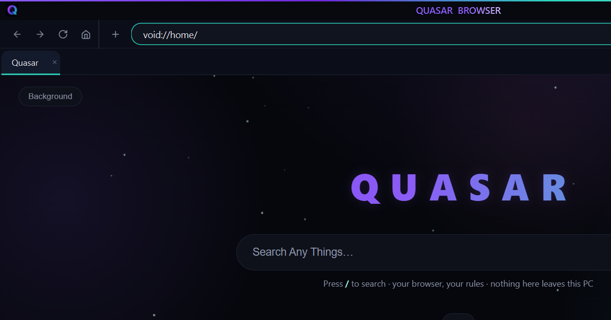

<div align="center">


# Quasar Browser — Official Website

**Landing site for Quasar Browser — a private, offline-first browser for Windows.**

Static HTML · zero build step · served by GitHub Pages

[](https://quasarbrowser.github.io)
[](https://github.com/quasarbrowser/quasarbrowser.github.io/releases)
[](https://github.com/quasarbrowser/quasarbrowser.github.io/releases)
[](https://github.com/quasarbrowser/quasarbrowser.github.io/releases)
[](https://quasarbrowser.github.io)

<p>
  <a href="https://quasarbrowser.github.io"><b>Visit the site</b></a> ·
  <a href="https://quasarbrowser.github.io/download.html"><b>Download</b></a> ·
  <a href="https://quasarbrowser.github.io/guide.html"><b>Guide</b></a> ·
  <a href="https://github.com/quasarbrowser/quasarbrowser.github.io/releases"><b>Releases</b></a>
</p>

</div>

---



*Quasar Browser on Windows — `void://home/` start page, dark UI, nothing here leaves your PC.*

---

## About the site

This repository hosts the official **Quasar Browser** website — the pages people
land on to learn about the browser, read the guide and download it.

| Page | What it covers |
|---|---|
| `index.html` | Landing page — hero, features overview, how it works |
| `features.html` | Feature tour: ad blocker, fingerprint masking, Void Mode, zero telemetry |
| `download.html` | **Download page** — driven live by the repo's GitHub Releases |
| `guide.html` | Getting-started guide for new users |
| `void.html` | The Void Mode explainer (four encrypted hops) |
| `robots.txt` · `sitemap.xml` | Crawler config + sitemap |

**Design language:** dark void theme (`#06070D`), purple/teal accents, Inter type,
starfield canvas, Tailwind via CDN.

## About the browser

* **Windows 10 / 11, 64-bit** — no admin rights, no extra runtimes
* **12 bundled websites** run fully **offline** over the `void://` scheme
* **No telemetry, no signup, no data collection** — ever
* App source is **sealed inside the executable**; site data ships **encrypted**
  and re-seals itself after every run — nothing readable rests on disk
* Download assets (~461 MB installer) are published on the **[Releases page](https://github.com/quasarbrowser/quasarbrowser.github.io/releases)**

### Downloads served by this site

| Asset | Size | What it is |
|---|---|---|
| `Quasar Browser Setup.exe` | 461.3 MB | Recommended — installer wizard |
| `Quasar Browser.void` | 461.2 MB | Portable — rename to `.zip`, unzip, run |
| `Quasar Browser.zip` | 919.0 MB | Full package — both files together |

SHA-256 checksums ship inside every release description
(`setups/RELEASE_NOTES.md` in the project) and on the download page.

> **Live today:** the **Full Package** zip (919 MB) is served from
> [archive.org](https://archive.org/download/quasar-browser/Quasar%20Browser%20.zip);
> the buttons switch to GitHub Release assets automatically once the first
> release is published.

## How the download page works

`download.html` + `script.js` read the **GitHub Releases API** on load:

1. Latest release found → buttons get real asset URLs, version, size and date
   (meta cached ~10 minutes in `localStorage`).
2. No release yet → buttons honestly show **“Build coming soon”**.
3. API unreachable → the default `/releases/latest/download/…` hrefs still work.

> Asset names on a release must match **exactly** (spaces included):
> `Quasar Browser Setup.exe`, `Quasar Browser.void`, `Quasar Browser.zip`.

## Repository structure

```
Quasar Browser Website/
├── index.html            # landing page
├── features.html         # feature tour
├── guide.html            # user guide
├── download.html         # downloads (GitHub Releases driven)
├── void.html             # Void Mode explainer
├── style.css / script.js # shared styles + site JS
├── logo.png / void.png / favicon.ico
├── assets/
│   ├── css/  js/  images/
│   └── images/screenshots/   # README + docs screenshots
├── downloads/            # local-preview stash — git-ignored (see below)
├── robots.txt  sitemap.xml
└── index.void            # void-scheme entry page
```

## Hosting & deploying

The site is plain static files — **no build step**:

1. Push this repo as `<user>/<user>.github.io` (or any repo with Pages enabled).
2. GitHub → **Settings → Pages → Deploy from branch → `main` / `(root)`**.
3. The site goes live at `https://quasarbrowser.github.io`.

## Contributing & housekeeping rules

* **Keep no personal data** anywhere in this repo or on the site — ever.
* **Never commit build files**: GitHub hard-rejects files over **100 MB**.
  `.gitignore` already excludes `downloads/*`, `*.zip` and `*.exe`; release
  binaries belong on the **Releases** page (assets are ~461 MB each).
* Update `download.html` hashes + `RELEASE_NOTES.md` whenever a new build
  is published.

---

<div align="center">
  <sub>© Quasar Browser — your browser, your rules. No telemetry, no signup.</sub>
</div>
